<!-- readme-standard: 2026-11-02 -->

# GSR Desk · PIR®

*The General Service Representatives helpdesk, in the A.L.E.X. family of desk portals.*

 **You are here:** PIR® › `gsr-desk-public` · public · `main` is the working branch · hand-built, not a synced twin

##  TL;DR

1.  **What this is.** The GSRs' front door on the web: one hand-built page, [`index.html`](index.html).
2.  **Who it is for.** The fellowship's General Service Representatives.
3.  **Do this first.** Open the [live page](https://psychedelicsinrecovery.github.io/gsr-desk-public/), or type `/gsr` in [PIR®'s Discord](https://discord.gg/MyprTq8w95).

The General Service Representatives helpdesk, in the A.L.E.X. family of desk portals.

- **Live page:** https://psychedelicsinrecovery.github.io/gsr-desk-public/
- **The GSR record:** https://psychedelicsinrecovery.github.io/changelog-astro-public/changelog/gsr-com/
- **Ticket command:** `/gsr` in PIR's Discord

Built October 17, 2026, modeled on the PR Desk, so the fellowship's GSRs have a door of their own. The GSR Subcommittee's minutes unfold at the AstroLog, one meeting at a time.

PIR® and Psychedelics In Recovery™ are marks of Psychedelics In Recovery, a 501(c)(3) nonprofit. Code MIT, words CC BY-SA 4.0.

##  Suggest a change

Noticed something? Open an [issue](https://github.com/psychedelicsinrecovery/gsr-desk-public/issues) or a pull request against `main`; the people who tend it read them and a person with the role merges. Not on GitHub? Type `/gsr` in [PIR®'s Discord](https://discord.gg/MyprTq8w95).

The front door follows the living [README standard](https://github.com/drasticstatic/my-template/blob/main/README-STANDARD.md). Copy it, improve it.
